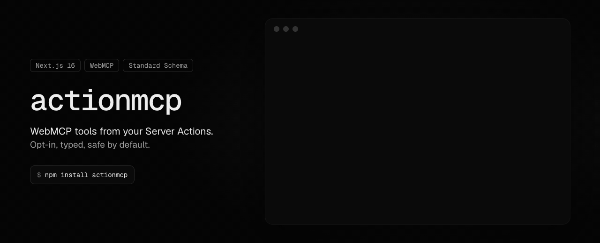

<p align="center">
  
</p>

<p align="center">
  <a href="https://www.npmjs.com/package/actionmcp"></a>
  <a href="https://github.com/galfrevn/actionmcp/actions/workflows/ci.yml"></a>
  <a href="https://www.npmjs.com/package/actionmcp#provenance"></a>
  <a href="https://www.npmjs.com/package/actionmcp"></a>
  <a href="LICENSE"></a>
  <br />
  <a href="https://github.com/galfrevn/actionmcp#requirements"></a>
  <a href="https://github.com/galfrevn/actionmcp#requirements"></a>
  <a href="https://github.com/galfrevn/actionmcp#requirements"></a>
  <a href="https://webmachinelearning.github.io/webmcp/"></a>
  <a href="https://standardschema.dev"></a>
</p>

actionmcp turns the Server Functions and routes that you opt in, in a Next.js App Router app, into typed [WebMCP](https://webmachinelearning.github.io/webmcp/) tools. Browser agents discover the tools on `document.modelContext` and call them with the user's session, through the same RPC that your UI uses.

## Install

```bash
npm install actionmcp
```

## Usage

Wrap the Next.js config. This generates the tool registry during `next build` and `next dev`.

`next.config.ts`:

```ts
import { withAgentTools } from 'actionmcp/config'
import type { NextConfig } from 'next'

const nextConfig: NextConfig = {}

export default withAgentTools()(nextConfig)
```

Mark a Server Function as a tool, with a description and a Standard Schema input. Your auth check stays in the action.

`app/todos/actions.ts`:

```ts
'use server'
import { agent } from 'actionmcp/server'
import { z } from 'zod'

export const addTodo = agent(
  {
    description: 'Add an item to the signed-in user’s todo list. Returns the created item.',
    input: z.object({ text: z.string().min(1).max(200) }),
  },
  async ({ text }) => {
    const user = await requireUser()
    return db.todo.create({ data: { text, userId: user.id } })
  },
)
```

Register the tools in a layout. They exist while that layout is mounted.

`app/todos/layout.tsx`:

```tsx
import { AgentTools } from 'actionmcp'

export default function Layout({ children }: { children: React.ReactNode }) {
  return (
    <>
      {children}
      <AgentTools />
    </>
  )
}
```

The [getting started guide](documentation/getting-started.md) covers each step, the CLI, and the devtools panel.

## Features

- **Three ways to opt in.** `agent()` for new or edited actions, `defineAgentTools()` for existing `useActionState` and next-safe-action actions without changing them, and an experimental `@agent` JSDoc tag.
- **Schemas from your validator.** The input schema comes from Zod, Valibot, or ArkType through Standard JSON Schema. `agent()` validates with the same schema on the server.
- **Scope by layout.** `<AgentTools include={['team.*']} />` in a segment layout registers those tools only under that segment.
- **A typed `navigate` tool**, generated from `app/`.
- **Results that an agent can act on.** A failure is a value such as `{ ok: false, error: { code: 'invalid_input', issues } }`, because browsers hide the reason of a rejected tool call.
- **A CLI.** `actionmcp inspect` lists what is exposed. `actionmcp doctor` reports problems with a fix for each.
- **A devtools panel** for development, and an [in-app chat example](examples/chat) that uses the same tools through the AI SDK.

## Security defaults

- Opt-in only. Nothing becomes a tool without `agent()`, `tool()`, or `@agent`.
- Consequential by default. A tool is consequential unless it is marked `readOnly`.
- Human confirmation. An in-page dialog asks a person before a consequential tool runs.
- Native RPC only. Tools execute through the Server Function RPC, with no new endpoints.

Authentication, ownership checks, and rate limiting stay inside your actions. The [security page](documentation/security.md) has the per-tool checklist and the threat model.

## How it works

1. A build step scans the project for `agent()` calls, the `agent-tools.ts` registry, and `@agent` tags. It writes `.agent-tools/registry.ts` and `.agent-tools/manifest.json`.
2. `<AgentTools />`, a Server Component, reads the registry, converts the schemas to JSON Schema on the server, and passes the definitions and the Server Function references to a Client Component.
3. The Client Component registers the tools on `document.modelContext` and unregisters them when its layout unmounts.
4. When an agent calls a tool, the page asks for confirmation if the tool is consequential, then calls the Server Function reference. Next.js sends the same POST as for a call from your UI and revalidates the page.

The validator, the registry, and the analyzer stay on the server. The [architecture page](documentation/architecture.md) describes each part.

## Browser support

WebMCP is a Community Group draft, and browser support changes often. The [implementation status page](https://github.com/webmachinelearning/webmcp/blob/main/implementation-status.md) of the draft lists the browsers and agents that implement it.

The `polyfill` option of `<AgentTools />` loads [`@w3c/webmcp-polyfill`](https://github.com/w3c-oss/webmcp-polyfill) when the browser has no `document.modelContext`. It serves an in-app chat, the devtools panel, and tests. Native browser agents do not see tools that the polyfill registers.

## Requirements

- Next.js 16.x with the App Router.
- React 19.2 or later.
- Node.js 22.18 or later.
- A validator with Standard JSON Schema support: Zod 4.2+, ArkType 2.1.28+, or Valibot 1.2+ with `@valibot/to-json-schema`.
- For the experimental `@agent` tag only: `ts-json-schema-generator` as a development dependency.

## Examples

| Example | Shows |
|---|---|
| [`examples/basic`](examples/basic) | A todo app with `agent()` tools |
| [`examples/formdata`](examples/formdata) | Existing `useActionState` actions with `fromFormDataAction()` |
| [`examples/safe-action`](examples/safe-action) | A next-safe-action action with `fromSafeAction()` |
| [`examples/jsdoc`](examples/jsdoc) | The experimental `@agent` tag |
| [`examples/chat`](examples/chat) | An in-app assistant with the AI SDK WebMCP transport |
| [`examples/demo`](examples/demo) | The chat example prepared for a public deployment, with a list per visitor and limits on the model |

```bash
pnpm install
pnpm build
pnpm --filter example-basic dev
```

## Benchmark

[`bench/`](bench/README.md) compares one agent that clicks through a demo app with the same agent calling the WebMCP tools. Four runs are published, with three models and five tasks. In all four the WebMCP mode used fewer tokens and less time on the multi-step task, fewer tokens on the invitation task, and more tokens on the read-only task. On the other two tasks it used fewer tokens in three of the four runs. The [results](bench/README.md#results) include every run and the limits of the method.

## Documentation

- [Getting started](documentation/getting-started.md)
- [API reference](documentation/api-reference.md)
- [Security](documentation/security.md)
- [Architecture](documentation/architecture.md)
- [Testing](documentation/testing.md)
- [FAQ](documentation/faq.md)

## Contributing

Start with [CONTRIBUTING.md](CONTRIBUTING.md). Participation is governed by the [code of conduct](CODE_OF_CONDUCT.md).

## Security

Report vulnerabilities privately. Do not open a public issue for them. See [SECURITY.md](SECURITY.md).

## License

MIT. See [LICENSE](LICENSE).

actionmcp builds on the [WebMCP draft](https://webmachinelearning.github.io/webmcp/) of the Web Machine Learning Community Group, [`@w3c/webmcp-polyfill`](https://github.com/w3c-oss/webmcp-polyfill), [Standard Schema](https://standardschema.dev), the [AI SDK](https://github.com/vercel/ai), and [agent-browser](https://github.com/vercel-labs/agent-browser).
