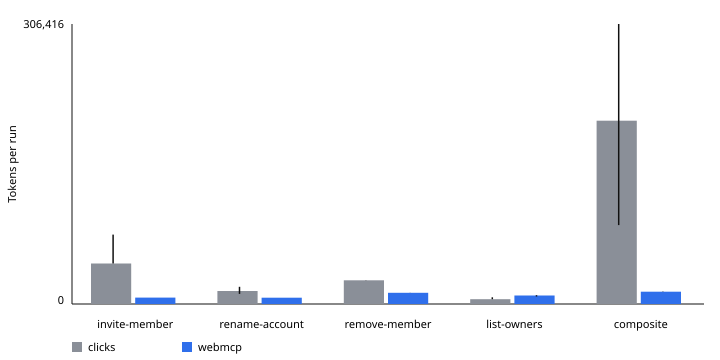

# Benchmark summary

Every run is in `runs.jsonl`, including the failed ones. Success is verified against the database, not against the agent's answer.

## Environment

```json
{
  "type": "environment",
  "model": "anthropic/claude-haiku-5.5",
  "provider": "openrouter",
  "maxSteps": 30,
  "commit": "cba8b405af61d34ccf000e760dc1b446c1d334d1",
  "dirty": false,
  "node": "v26.7.0",
  "agentBrowser": "agent-browser 0.44.0",
  "next": "Next.js v16.4.6"
}
```

## Results

| Task | Mode | Success | Tokens (median) | Tokens (p90) | Time ms (median) | Time ms (p90) | Tool calls (median) | Errors |
| --- | --- | --- | --- | --- | --- | --- | --- | --- |
| invite-member | clicks | 20/20 | 44,338 | 75,899 | 7,399 | 9,166 | 10 | 0 |
| invite-member | webmcp | 20/20 | 6,994 | 6,995 | 3,159 | 3,242 | 3 | 0 |
| rename-account | clicks | 19/20 | 14,178 | 18,805 | 6,681 | 8,975 | 10 | 0 |
| rename-account | webmcp | 20/20 | 6,906 | 6,916 | 3,018 | 3,174 | 3 | 0 |
| remove-member | clicks | 20/20 | 25,897 | 26,051 | 5,424 | 5,663 | 7 | 0 |
| remove-member | webmcp | 20/20 | 12,275 | 12,408 | 4,267 | 4,486 | 4 | 0 |
| list-owners | clicks | 20/20 | 5,263 | 7,337 | 2,111 | 3,885 | 2 | 0 |
| list-owners | webmcp | 20/20 | 9,325 | 9,627 | 3,524 | 3,750 | 3 | 0 |
| composite | clicks | 20/20 | 200,641 | 306,416 | 17,943 | 25,160 | 23 | 0 |
| composite | webmcp | 20/20 | 13,419 | 13,547 | 5,832 | 6,203 | 6 | 0 |



## Limits

- This is one app and 5 tasks. The numbers do not generalize to other apps.
- agent-browser announces the page tools to the agent, which favors the WebMCP mode.
- In the WebMCP mode the confirmation dialog is accepted by a test hook, so human latency is not measured.
