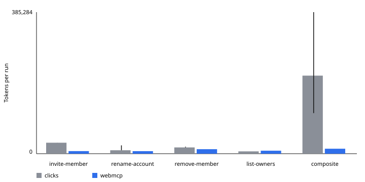

# Benchmark summary

Every run is in `runs.jsonl`, including the failed ones. Success is verified against the database, not against the agent's answer.

## Environment

```json
{
  "type": "environment",
  "model": "anthropic/claude-sonnet-5.5",
  "provider": "openrouter",
  "maxSteps": 30,
  "commit": "7e85da98e2be857fa1fdacc7875370bbe207ead7",
  "dirty": false,
  "node": "v26.7.0",
  "agentBrowser": "agent-browser 0.44.0",
  "next": "Next.js v16.4.6"
}
```

## Results

| Task | Mode | Success | Tokens (median) | Tokens (p90) | Time ms (median) | Time ms (p90) | Tool calls (median) | Errors |
| --- | --- | --- | --- | --- | --- | --- | --- | --- |
| invite-member | clicks | 20/20 | 29,870 | 29,937 | 7,702 | 8,509 | 8 | 0 |
| invite-member | webmcp | 20/20 | 6,949 | 6,949 | 3,615 | 3,813 | 3 | 0 |
| rename-account | clicks | 20/20 | 9,331 | 22,732 | 6,131 | 11,379 | 6 | 0 |
| rename-account | webmcp | 20/20 | 6,904 | 6,904 | 3,407 | 3,555 | 3 | 0 |
| remove-member | clicks | 20/20 | 17,013 | 18,957 | 4,487 | 5,406 | 4 | 0 |
| remove-member | webmcp | 20/20 | 12,224 | 12,232 | 4,973 | 5,213 | 4 | 0 |
| list-owners | clicks | 20/20 | 6,273 | 6,273 | 2,636 | 2,695 | 2 | 0 |
| list-owners | webmcp | 20/20 | 8,122 | 8,141 | 3,420 | 3,569 | 3 | 0 |
| composite | clicks | 19/20 | 212,401 | 385,284 | 25,341 | 37,286 | 25 | 0 |
| composite | webmcp | 20/20 | 13,479 | 13,547 | 6,597 | 6,755 | 7 | 0 |



## Limits

- This is one app and 5 tasks. The numbers do not generalize to other apps.
- agent-browser announces the page tools to the agent, which favors the WebMCP mode.
- In the WebMCP mode the confirmation dialog is accepted by a test hook, so human latency is not measured.
