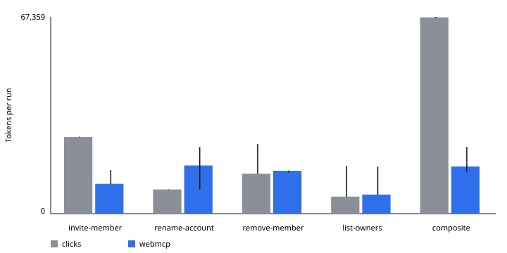

# Benchmark summary

Every run is in `runs.jsonl`, including the failed ones. Success is verified against the database, not against the agent's answer.

## Environment

```json
{
  "type": "environment",
  "model": "deepseek/deepseek-v4.1-flash-1017",
  "provider": "openrouter",
  "maxSteps": 30,
  "commit": "27a6706d2d8ab4fe6038fa1b25eb85df30992af3",
  "node": "v26.7.0",
  "agentBrowser": "agent-browser 0.44.0",
  "next": "Next.js v16.4.6"
}
```

## Results

| Task | Mode | Success | Tokens (median) | Tokens (p90) | Time ms (median) | Time ms (p90) | Tool calls (median) | Errors |
| --- | --- | --- | --- | --- | --- | --- | --- | --- |
| invite-member | clicks | 20/20 | 26,248 | 26,334 | 8,831 | 15,461 | 8 | 0 |
| invite-member | webmcp | 20/20 | 10,191 | 14,928 | 10,141 | 38,238 | 4 | 0 |
| rename-account | clicks | 20/20 | 8,271 | 8,357 | 10,511 | 29,058 | 6 | 0 |
| rename-account | webmcp | 20/20 | 16,486 | 22,773 | 13,226 | 19,975 | 6 | 0 |
| remove-member | clicks | 20/20 | 13,691 | 23,842 | 8,587 | 13,932 | 5 | 0 |
| remove-member | webmcp | 20/20 | 14,673 | 14,754 | 8,780 | 11,209 | 5 | 0 |
| list-owners | clicks | 20/20 | 5,820 | 16,359 | 6,069 | 11,996 | 3 | 0 |
| list-owners | webmcp | 20/20 | 6,529 | 16,115 | 5,558 | 7,910 | 3 | 0 |
| composite | clicks | 20/20 | 67,199 | 67,359 | 19,533 | 26,382 | 13 | 0 |
| composite | webmcp | 20/20 | 16,160 | 22,838 | 9,480 | 18,227 | 8 | 0 |



## Limits

- This is one app and 5 tasks. The numbers do not generalize to other apps.
- agent-browser announces the page tools to the agent, which favors the WebMCP mode.
- In the WebMCP mode the confirmation dialog is accepted by a test hook, so human latency is not measured.
