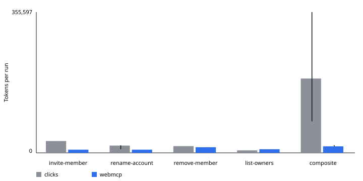

# Benchmark summary

Every run is in `runs.jsonl`, including the failed ones. Success is verified against the database, not against the agent's answer.

## Environment

```json
{
  "type": "environment",
  "model": "anthropic/claude-sonnet-5.5",
  "provider": "openrouter",
  "maxSteps": 30,
  "commit": "7cb6bcb38e7065bb5bd7394507a981582bffb9d8",
  "node": "v26.7.0",
  "agentBrowser": "agent-browser 0.44.0",
  "next": "Next.js v16.4.6"
}
```

## Results

| Task | Mode | Success | Tokens (median) | Tokens (p90) | Time ms (median) | Time ms (p90) | Tool calls (median) | Errors |
| --- | --- | --- | --- | --- | --- | --- | --- | --- |
| invite-member | clicks | 20/20 | 29,903 | 29,927 | 9,130 | 9,837 | 8 | 0 |
| invite-member | webmcp | 20/20 | 8,004 | 8,030 | 4,327 | 4,901 | 3 | 0 |
| rename-account | clicks | 20/20 | 18,339 | 18,962 | 10,837 | 11,794 | 11 | 0 |
| rename-account | webmcp | 20/20 | 7,973 | 8,020 | 3,991 | 4,172 | 3 | 0 |
| remove-member | clicks | 20/20 | 17,003 | 17,014 | 5,213 | 6,019 | 4 | 0 |
| remove-member | webmcp | 20/20 | 14,202 | 14,238 | 5,583 | 5,864 | 4 | 0 |
| list-owners | clicks | 20/20 | 6,273 | 6,273 | 3,036 | 3,064 | 2 | 0 |
| list-owners | webmcp | 20/20 | 9,201 | 9,225 | 3,835 | 4,055 | 3 | 0 |
| composite | clicks | 17/20 | 187,717 | 355,597 | 27,402 | 39,303 | 23 | 0 |
| composite | webmcp | 20/20 | 16,355 | 19,392 | 7,540 | 8,796 | 7 | 0 |



## Limits

- This is one app and 5 tasks. The numbers do not generalize to other apps.
- agent-browser announces the page tools to the agent, which favors the WebMCP mode.
- In the WebMCP mode the confirmation dialog is accepted by a test hook, so human latency is not measured.
