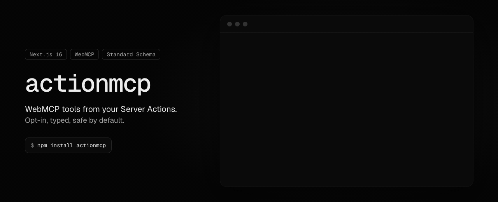

<p align="center">
  
</p>

<p align="center">
  <a href="https://www.npmjs.com/package/actionmcp"></a>
  <a href="https://github.com/galfrevn/actionmcp/actions/workflows/ci.yml"></a>
  <a href="https://www.npmjs.com/package/actionmcp#provenance"></a>
  <a href="https://www.npmjs.com/package/actionmcp"></a>
  <a href="https://github.com/galfrevn/actionmcp/blob/main/LICENSE"></a>
  <br />
  <a href="https://github.com/galfrevn/actionmcp#requirements"></a>
  <a href="https://github.com/galfrevn/actionmcp#requirements"></a>
  <a href="https://github.com/galfrevn/actionmcp#requirements"></a>
  <a href="https://webmachinelearning.github.io/webmcp/"></a>
  <a href="https://standardschema.dev"></a>
</p>

actionmcp turns the Server Functions and routes that you opt in, in a Next.js App Router app, into typed WebMCP tools. Browser agents discover the tools on `document.modelContext` and call them with the user's session.

The documentation is in the repository: https://github.com/galfrevn/actionmcp#readme

## Install

```bash
npm install actionmcp
```

actionmcp requires Next.js 16.x and React 19.2 or later. The experimental `@agent` tag also needs `ts-json-schema-generator` as a development dependency.

## Usage

`next.config.ts`:

```ts
import { withAgentTools } from 'actionmcp/config'
import type { NextConfig } from 'next'

const nextConfig: NextConfig = {}

export default withAgentTools()(nextConfig)
```

`app/todos/actions.ts`:

```ts
'use server'
import { agent } from 'actionmcp/server'
import { z } from 'zod'

export const addTodo = agent(
  {
    description: 'Add an item to the signed-in user’s todo list. Returns the created item.',
    input: z.object({ text: z.string().min(1).max(200) }),
  },
  async ({ text }) => {
    const user = await requireUser()
    return db.todo.create({ data: { text, userId: user.id } })
  },
)
```

`app/todos/layout.tsx`:

```tsx
import { AgentTools } from 'actionmcp'

export default function Layout({ children }: { children: React.ReactNode }) {
  return (
    <>
      {children}
      <AgentTools />
    </>
  )
}
```

## Security defaults

- Nothing becomes a tool without `agent()`, `tool()`, or `@agent`.
- A tool is consequential unless it is marked `readOnly`.
- An in-page dialog asks a human before a consequential tool runs.
- Tools run through the native Server Function RPC. actionmcp adds no endpoint.

The checklist for each tool and the threat model are in [security.md](https://github.com/galfrevn/actionmcp/blob/main/documentation/security.md).

## License

MIT
